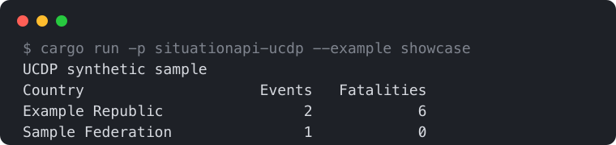

# situationapi

Typed, blocking Rust clients for 7 open world-watch feeds (RSS/Atom news, armed-conflict events, maritime chokepoint transits, federal contract awards, WARN layoff notices, large on-chain transfers and arXiv research velocity), so you can monitor what is happening without writing a scraper per source.



The image is the output of `cargo run -p situationapi-ucdp --example showcase`: the example decodes the crate's own synthetic test fixture (the real upstream layout, invented values) through the public API, offline. Reproduce it with `docs/showcase/make-screenshots.sh` (see [docs/showcase.md](docs/showcase.md)).

## Install

These crates are not on crates.io. Add the one you need as a git dependency:

```toml
[dependencies]
situationapi-arxiv = { git = "https://github.com/davidawad/situationapi", package = "situationapi-arxiv" }
```

Pin `rev = "<commit>"` or `tag = "<tag>"` for reproducible builds. Each crate is independent: depend only on the one you need. No crate reads global state; keys and an optional cache directory are passed by the caller. HTTP is blocking `reqwest` with rustls (no OpenSSL), with jittered retry on 429, 5xx and transport errors.

Build everything: `cargo build --workspace`. The offline tests need no network or keys: `cargo test --workspace`. Live tests are `#[ignore]`d; run them with `cargo test -p <crate> -- --ignored` (keyed sources print `credential_missing` and pass when the key is absent).

## Crates

| Crate | What it covers | Details |
| --- | --- | --- |
| `situationapi-arxiv` | Reusable blocking Rust client for the arXiv Atom API | [README](crates/situationapi-arxiv/README.md) |
| `situationapi-feeds` | Reusable conditional RSS and Atom feed client | [README](crates/situationapi-feeds/README.md) |
| `situationapi-gdelt-doc` | Reusable GDELT DOC 2.0 article-list client | [README](crates/situationapi-gdelt-doc/README.md) |
| `situationapi-mempool` | Reusable blocking clients for public blockchain data APIs | [README](crates/situationapi-mempool/README.md) |
| `situationapi-portwatch` | Reusable client for bounded IMF PortWatch chokepoint queries | [README](crates/situationapi-portwatch/README.md) |
| `situationapi-ucdp` | Reusable Rust client for UCDP GED and Candidate event data | [README](crates/situationapi-ucdp/README.md) |
| `situationapi-usaspending` | Reusable USAspending.gov API v2 client. | [README](crates/situationapi-usaspending/README.md) |
| `situationapi-warn` | Reusable client for normalized public WARN notice data | [README](crates/situationapi-warn/README.md) |

Every crate README has a usage example (mirrored by `examples/basic.rs`), the endpoints or files it covers, how authentication works, and a terms table (automated access, redistribution, attribution, rate limits) with links to the upstream terms as reviewed. Test fixtures keep each upstream's layout but carry synthesized values, except trimmed US federal public-domain samples.

This project is not affiliated with or endorsed by any of the data providers. Using a client does not change a provider's terms: check them before you redistribute data.

## License

GPL-3.0-or-later; see [LICENSE](LICENSE).
