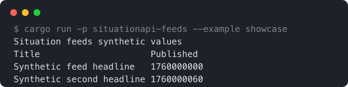
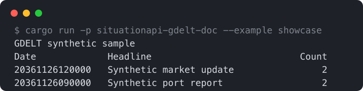
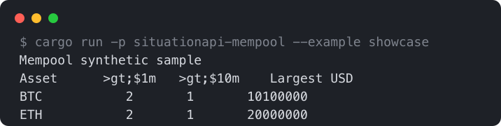
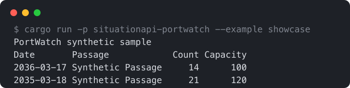
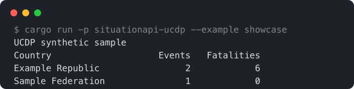
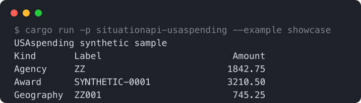
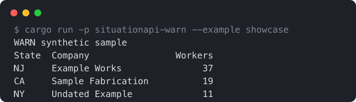

# Showcase

Every image here is generated offline: no network, no API keys, no upstream calls. Each crate's `examples/showcase.rs` decodes that crate's synthetic test fixture (the real upstream layout, invented values) through its public API and prints a small table; the script wraps the text in a terminal frame and renders the PNG.

```sh
docs/showcase/make-screenshots.sh           # both stages
docs/showcase/make-screenshots.sh --text    # run every example (needs cargo)
docs/showcase/make-screenshots.sh --render  # SVG + PNG (needs rsvg-convert: brew install librsvg)
```

Every client also has `examples/basic.rs`, which calls the live upstream (network, and a key where its README says so).

## `situationapi-feeds`

Reusable conditional RSS and Atom feed client



## `situationapi-gdelt-doc`

Reusable GDELT DOC 2.0 article-list client



## `situationapi-mempool`

Reusable blocking clients for public blockchain data APIs



## `situationapi-portwatch`

Reusable client for bounded IMF PortWatch chokepoint queries



## `situationapi-ucdp`

Reusable Rust client for UCDP GED and Candidate event data



## `situationapi-usaspending`

Reusable USAspending.gov API v2 client.



## `situationapi-warn`

Reusable client for normalized public WARN notice data


